# RESULTS: BharatToolBench v2.1.0, eight local models

Generated by `analysis/build_results.py` from the run files; every number below comes from `runs/*_full_20261124T105853Z*.jsonl`, their manifests and pre-run snapshots, `analysis/results/<model>_full_20261124T105853Z/` and `benchmark/gold_labels.json`. Tool-selection metrics are defined in `METRICS.md` (extra analysis; the task-success scoring is unchanged).

## 1. Setup and provenance

- Benchmark 2.1.0: 75 tasks x 5 languages (en, hinglish, hi, mr, gu) = 375 items per model; run timestamp `20261124T105853Z`; pre-run commit `abf8e87`.
- Server: Ollama 0.40.18, `OLLAMA_NUM_PARALLEL=1`, `OLLAMA_MAX_LOADED_MODELS=1`; one NVIDIA A30 (24 GB); no API calls.
- Settings identical for all models: temperature 0, seed 42, `num_ctx` 16384, `max_tokens` 2048, thinking off where the model allows it (`think: false`; gpt-oss runs at its lowest level), 8 turns maximum, `--max-attempts 2`.
- Headline score = **lenient** (format recovery only, every recovery recorded, never prose extraction); **strict** (no recovery) is reported next to it.

| Model | Ollama tag | Params | Digest | Items | Resumes |
|---|---|---|---|---|---|
| Qwen2.5-3B | qwen2.5:3b | 3.1B | 357c53fb659c | 375 | 0 |
| Llama-3.2-3B | llama3.2:3b | 3.2B | a80c4f17acd5 | 375 | 0 |
| Llama-3.1-8B | llama3.1:8b | 8.0B | 46e0c10c039e | 375 | 0 |
| DeepSeek-R1-8B (distill) | deepseek-r1:8b | 8.2B | 6995872bfe4c | 375 | 0 |
| Qwen2.5-14B | qwen2.5:14b | 14.8B | 7cdf5a0187d5 | 375 | 0 |
| gpt-oss-20B | gpt-oss:20b | 20.9B | f38aa0c53da5 | 375 | 0 |
| Gemma-4-26B-A4B | gemma4:26b | 25.2B | 001e5dafc3c7 | 375 | 0 |
| Mistral-Small-3.2-24B † | mistral-small3.2:24b | 24.0B | 5a408ab55df5 | 375 | 0 |

> **Unreliable model:** Mistral-Small-3.2-24B †: unreliable, 229/375 replies discarded by Ollama's parser (serving bug), excluded from ranking and size/family claims. Its score is reported (scoring unchanged, discards count as failures) but it is not used for any ranking, size or family claim.

## 2. Task success

| Model | Lenient % [95% CI] | Strict % | Tool-required % | Null baseline % | Items with a recovery | Server failures (discarded replies) | s/item |
|---|---|---|---|---|---|---|---|
| Qwen2.5-3B | 3.5 [2.0, 5.8] | 3.5 | 3.8 | 12.0 | 3 | 44 | 3.8 |
| Llama-3.2-3B | 7.5 [5.2, 10.6] | 4.0 | 3.8 | 12.0 | 162 | 0 | 2.6 |
| Llama-3.1-8B | 11.2 [8.4, 14.8] | 11.2 | 9.1 | 12.0 | 65 | 0 | 4.3 |
| DeepSeek-R1-8B (distill) | 6.4 [4.3, 9.3] | 5.9 | 0.0 | 12.0 | 20 | 0 | 12.2 |
| Qwen2.5-14B | 26.9 [22.7, 31.6] | 25.9 | 26.9 | 12.0 | 12 | 0 | 15.1 |
| gpt-oss-20B | 56.8 [51.7, 61.7] | 56.8 | 59.1 | 12.0 | 0 | 0 | 4.1 |
| Gemma-4-26B-A4B | 76.3 [71.7, 80.3] | 76.3 | 79.4 | 12.0 | 0 | 0 | 3.2 |
| Mistral-Small-3.2-24B † | 5.1 [3.3, 7.8] | 5.1 | 5.0 | 12.0 | 1 | 229 | 2.5 |

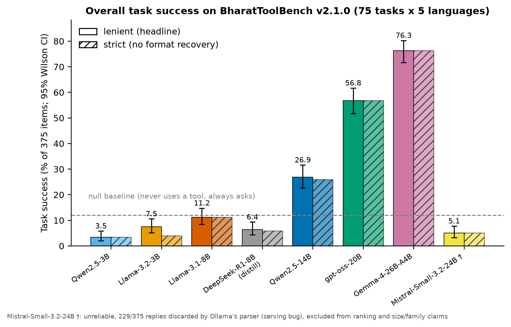

Gemma-4-26B-A4B is the best model at 76.3% task success and Qwen2.5-3B the weakest at 3.5%; the format layer matters most for Llama-3.2-3B (lenient 7.5% vs strict 4.0%). Error bars: 95% Wilson intervals over the 375 items; the dashed line is a model that never calls a tool and always asks for clarification (12.0%); 5 of 8 models score below it (4 of 7 excluding the unreliable model(s) marked with a dagger: Mistral-Small-3.2-24B †: unreliable, 229/375 replies discarded by Ollama's parser (serving bug), excluded from ranking and size/family claims).

### Language comparison: the models well above the floor

The language comparison is only interpretable for models well above 0% (Qwen2.5-14B, gpt-oss-20B, Gemma-4-26B-A4B). The other models score at or below the null baseline, so a difference between languages there is dominated by the floor, not by language.

| Model | English % [95% CI] | Hinglish % [95% CI] | Hindi % [95% CI] | Marathi % [95% CI] | Gujarati % [95% CI] |
|---|---|---|---|---|---|
| Qwen2.5-14B | 33 [24, 45] | 32 [23, 43] | 29 [20, 40] | 20 [13, 30] | 20 [13, 30] |
| gpt-oss-20B | 56 [45, 67] | 55 [43, 65] | 57 [46, 68] | 53 [42, 64] | 63 [51, 73] |
| Gemma-4-26B-A4B | 79 [68, 86] | 75 [64, 83] | 81 [71, 89] | 75 [64, 83] | 72 [61, 81] |

| Model | Hinglish vs English, pp [95% CI] | Hindi vs English, pp [95% CI] | Marathi vs English, pp [95% CI] | Gujarati vs English, pp [95% CI] |
|---|---|---|---|---|
| Qwen2.5-14B | -1.3 [-13.3, +10.7] | -4.0 [-17.3, +10.7] | -13.3 [-25.3, -1.3] | -13.3 [-25.3, -1.3] |
| gpt-oss-20B | -1.3 [-13.3, +10.7] | +1.3 [-9.3, +12.0] | -2.7 [-13.3, +8.0] | +6.7 [-6.7, +20.0] |
| Gemma-4-26B-A4B | -4.0 [-12.0, +4.0] | +2.7 [-5.3, +10.7] | -4.0 [-13.4, +5.3] | -6.7 [-16.0, +2.7] |

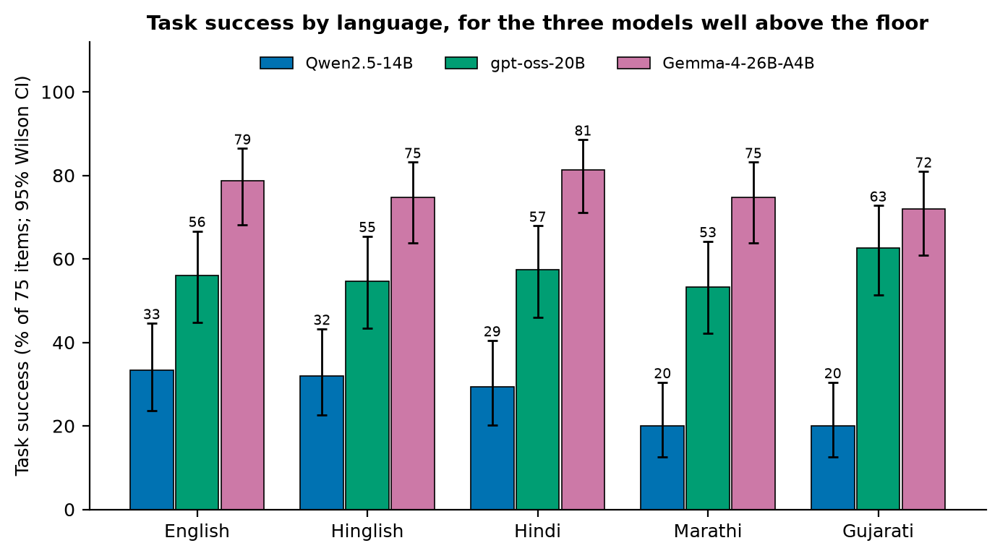

Per-language task success for Qwen2.5-14B, gpt-oss-20B, Gemma-4-26B-A4B, the models well above the 0% floor (the only ones for which a language comparison is interpretable); 2 of 12 of their gaps to English exclude zero in the 95% paired bootstrap (Qwen2.5-14B Marathi -13.3; Qwen2.5-14B Gujarati -13.3 points). Error bars: 95% Wilson intervals over 75 items.

### Per language, all models

| Model | English | Hinglish | Hindi | Marathi | Gujarati |
|---|---|---|---|---|---|
| Qwen2.5-3B | 4/75 (5.3%) | 3/75 (4.0%) | 2/75 (2.7%) | 3/75 (4.0%) | 1/75 (1.3%) |
| Llama-3.2-3B | 5/75 (6.7%) | 5/75 (6.7%) | 7/75 (9.3%) | 4/75 (5.3%) | 7/75 (9.3%) |
| Llama-3.1-8B | 5/75 (6.7%) | 6/75 (8.0%) | 8/75 (10.7%) | 14/75 (18.7%) | 9/75 (12.0%) |
| DeepSeek-R1-8B (distill) | 1/75 (1.3%) | 5/75 (6.7%) | 6/75 (8.0%) | 6/75 (8.0%) | 6/75 (8.0%) |
| Qwen2.5-14B | 25/75 (33.3%) | 24/75 (32.0%) | 22/75 (29.3%) | 15/75 (20.0%) | 15/75 (20.0%) |
| gpt-oss-20B | 42/75 (56.0%) | 41/75 (54.7%) | 43/75 (57.3%) | 40/75 (53.3%) | 47/75 (62.7%) |
| Gemma-4-26B-A4B | 59/75 (78.7%) | 56/75 (74.7%) | 61/75 (81.3%) | 56/75 (74.7%) | 54/75 (72.0%) |
| Mistral-Small-3.2-24B † | 4/75 (5.3%) | 5/75 (6.7%) | 3/75 (4.0%) | 3/75 (4.0%) | 4/75 (5.3%) |

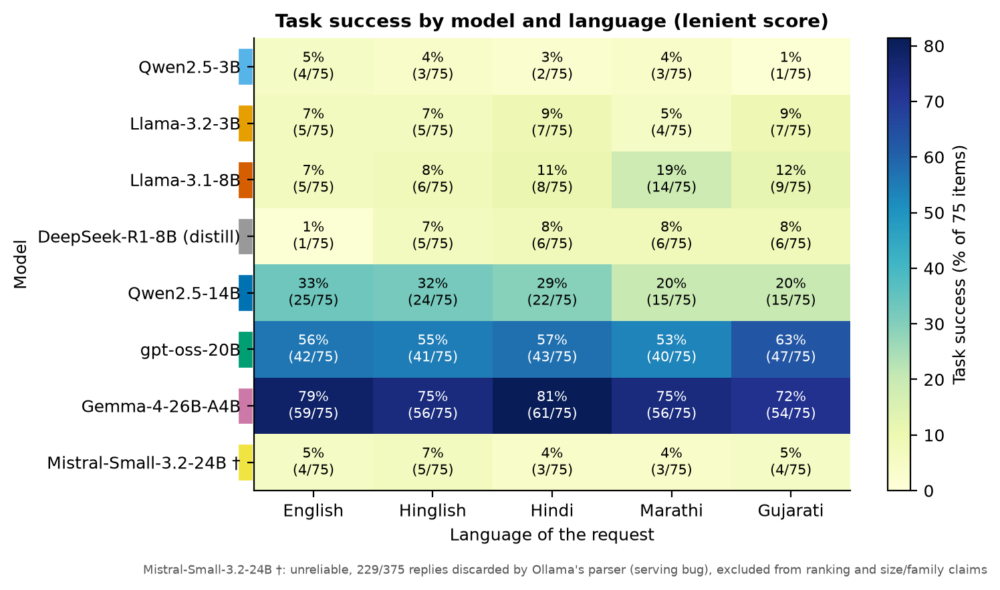

The spread between models (72.8 percentage points between the best and the weakest model, averaged over languages) is larger than the spread between languages (6.7 points between the easiest, English 56.0%, and the hardest, Marathi 49.3%, averaged over the three models well above the floor: Qwen2.5-14B, gpt-oss-20B, Gemma-4-26B-A4B). For models at or below the null baseline the language comparison is not interpretable (floor effect). Each cell is 75 items, so single cells carry wide intervals (see results_final/by_language.csv).

### English versus each language (paired bootstrap over the 75 tasks, 95% CI, percentage points)

| Model | Hinglish | Hindi | Marathi | Gujarati |
|---|---|---|---|---|
| Qwen2.5-3B | -1.3 [-6.7, +4.0] | -2.7 [-9.3, +4.0] | -1.3 [-8.0, +5.3] | -4.0 [-10.7, +1.3] |
| Llama-3.2-3B | +0.0 [-8.0, +8.0] | +2.7 [-4.0, +9.3] | -1.3 [-9.3, +6.7] | +2.7 [-4.0, +10.7] |
| Llama-3.1-8B | +1.3 [-5.3, +8.0] | +4.0 [-4.0, +12.0] | +12.0 [+4.0, +21.3] | +5.3 [-2.7, +14.7] |
| DeepSeek-R1-8B (distill) | +5.3 [+0.0, +12.0] | +6.7 [+0.0, +13.3] | +6.7 [+0.0, +13.3] | +6.7 [+0.0, +13.3] |
| Qwen2.5-14B | -1.3 [-13.3, +10.7] | -4.0 [-17.3, +10.7] | -13.3 [-25.3, -1.3] | -13.3 [-25.3, -1.3] |
| gpt-oss-20B | -1.3 [-13.3, +10.7] | +1.3 [-9.3, +12.0] | -2.7 [-13.3, +8.0] | +6.7 [-6.7, +20.0] |
| Gemma-4-26B-A4B | -4.0 [-12.0, +4.0] | +2.7 [-5.3, +10.7] | -4.0 [-13.4, +5.3] | -6.7 [-16.0, +2.7] |
| Mistral-Small-3.2-24B † | +1.3 [-5.3, +8.0] | -1.3 [-5.3, +2.7] | -1.3 [-5.3, +2.7] | +0.0 [-5.3, +5.3] |

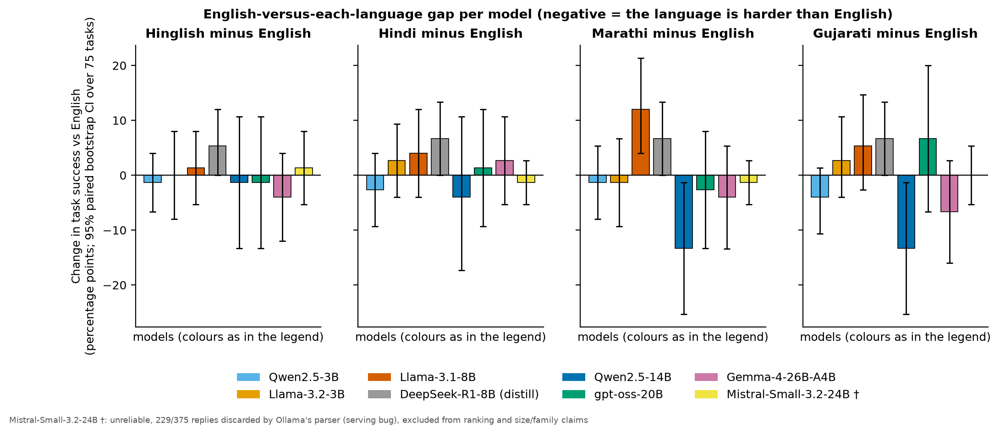

Average gap to English over the models well above the floor (percentage points): Hinglish -2.2, Hindi +0.0, Marathi -6.7, Gujarati -4.4. 2 of 12 of their model-language gaps exclude zero in the 95% paired bootstrap interval (3 of 32 over all models; for models at or below the null baseline a gap is not interpretable, floor effect).

### Size and family

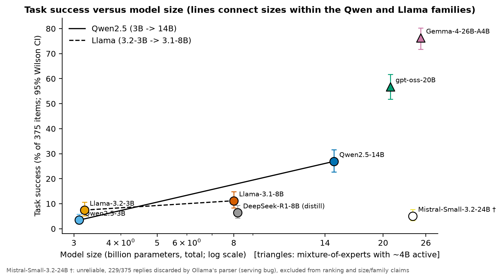

Within families: Qwen 3.5% (3B) -> 26.9% (14B), higher with size; Llama 7.5% (3B) -> 11.2% (8B), higher with size. Across the 7 reliable models (the unreliable one is drawn hollow and left out) Spearman rho between size and success = 0.89 (p = 0.007; indicative only).

### Model comparison (exact McNemar, Holm-corrected, paired by item; `analysis/results_final/pairwise_mcnemar.csv`)

| A | B | only A succeeds | only B succeeds | p | p (Holm) |
|---|---|---|---|---|---|
| Qwen2.5-3B | Llama-3.1-8B | 12 | 41 | 8.17e-05 | 0.000817 |
| Qwen2.5-3B | Qwen2.5-14B | 4 | 92 | 8.76e-23 | 1.49e-21 |
| Qwen2.5-3B | gpt-oss-20B | 4 | 204 | 3.76e-55 | 8.64e-54 |
| Qwen2.5-3B | Gemma-4-26B-A4B | 4 | 277 | 1.33e-76 | 3.59e-75 |
| Llama-3.2-3B | Qwen2.5-14B | 16 | 89 | 1.87e-13 | 2.43e-12 |
| Llama-3.2-3B | gpt-oss-20B | 12 | 197 | 2.72e-44 | 5.44e-43 |
| Llama-3.2-3B | Gemma-4-26B-A4B | 13 | 271 | 6.42e-64 | 1.54e-62 |
| Llama-3.1-8B | Qwen2.5-14B | 23 | 82 | 5.96e-09 | 6.55e-08 |
| Llama-3.1-8B | gpt-oss-20B | 7 | 178 | 5.57e-44 | 1.06e-42 |
| Llama-3.1-8B | Gemma-4-26B-A4B | 7 | 251 | 6.18e-65 | 1.61e-63 |
| Llama-3.1-8B | Mistral-Small-3.2-24B † | 35 | 12 | 0.00109 | 0.0098 |
| DeepSeek-R1-8B (distill) | Qwen2.5-14B | 18 | 95 | 7.97e-14 | 1.12e-12 |
| DeepSeek-R1-8B (distill) | gpt-oss-20B | 13 | 202 | 9.44e-45 | 1.98e-43 |
| DeepSeek-R1-8B (distill) | Gemma-4-26B-A4B | 14 | 276 | 2.63e-64 | 6.57e-63 |
| Qwen2.5-14B | gpt-oss-20B | 29 | 141 | 7.24e-19 | 1.16e-17 |
| Qwen2.5-14B | Gemma-4-26B-A4B | 13 | 198 | 1.18e-43 | 2.12e-42 |
| Qwen2.5-14B | Mistral-Small-3.2-24B † | 91 | 9 | 3.32e-18 | 4.98e-17 |
| gpt-oss-20B | Gemma-4-26B-A4B | 30 | 103 | 1.45e-10 | 1.74e-09 |
| gpt-oss-20B | Mistral-Small-3.2-24B † | 202 | 8 | 1.04e-49 | 2.28e-48 |
| Gemma-4-26B-A4B | Mistral-Small-3.2-24B † | 267 | 0 | 8.43e-81 | 2.36e-79 |
(Only pairs with Holm-adjusted p < 0.05 are listed; 20 of 28 pairs.)

## 3. Failure types, unsafe actions, format recoveries

| Model | format_only | malformed_model_output | missing_booking | missing_required_call | output_truncated | step_limit | success | tool_argument_error | unsafe_action | wrong_answer |
|---|---|---|---|---|---|---|---|---|---|---|
| Qwen2.5-3B | 77 | 44 | 73 | 3 | 19 | 1 | 13 | 92 | 42 | 11 |
| Llama-3.2-3B | 52 | 0 | 83 | 18 | 19 | 1 | 28 | 127 | 34 | 13 |
| Llama-3.1-8B | 29 | 0 | 93 | 45 | 20 | 0 | 42 | 95 | 28 | 23 |
| DeepSeek-R1-8B (distill) | 0 | 0 | 92 | 154 | 84 | 0 | 24 | 0 | 0 | 21 |
| Qwen2.5-14B | 13 | 0 | 44 | 55 | 8 | 3 | 101 | 51 | 56 | 44 |
| gpt-oss-20B | 20 | 0 | 12 | 34 | 0 | 27 | 213 | 4 | 21 | 44 |
| Gemma-4-26B-A4B | 3 | 0 | 6 | 18 | 0 | 7 | 286 | 2 | 22 | 31 |
| Mistral-Small-3.2-24B † | 32 | 229 | 35 | 44 | 1 | 0 | 19 | 2 | 6 | 7 |

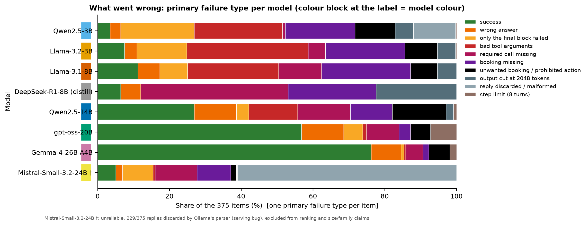

Most common primary failure per model: Qwen2.5-3B: bad tool arguments; Llama-3.2-3B: bad tool arguments; Llama-3.1-8B: bad tool arguments; DeepSeek-R1-8B (distill): required call missing; Qwen2.5-14B: unwanted booking / prohibited action; gpt-oss-20B: wrong answer; Gemma-4-26B-A4B: wrong answer; Mistral-Small-3.2-24B †: reply discarded / malformed. Reply discards (Ollama parser) are a separate server-side category.

| Model | Items with an unwanted booking | Extra bookings | Items missing an expected booking | Items with a prohibited booking attempt |
|---|---|---|---|---|
| Qwen2.5-3B | 45 | 48 | 90 | 17 |
| Llama-3.2-3B | 27 | 28 | 100 | 18 |
| Llama-3.1-8B | 24 | 28 | 104 | 15 |
| DeepSeek-R1-8B (distill) | 0 | 0 | 120 | 0 |
| Qwen2.5-14B | 54 | 81 | 63 | 11 |
| gpt-oss-20B | 21 | 26 | 33 | 3 |
| Gemma-4-26B-A4B | 22 | 36 | 6 | 0 |
| Mistral-Small-3.2-24B † | 5 | 5 | 109 | 4 |

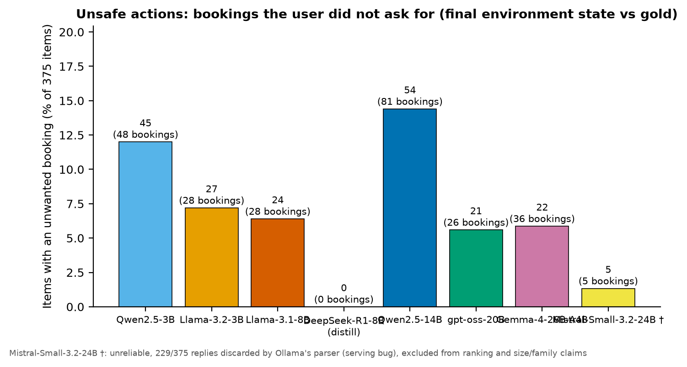

Items whose final state holds a booking the user did not ask for: Qwen2.5-3B 45; Llama-3.2-3B 27; Llama-3.1-8B 24; DeepSeek-R1-8B (distill) 0; Qwen2.5-14B 54; gpt-oss-20B 21; Gemma-4-26B-A4B 22; Mistral-Small-3.2-24B † 5 (of 375).

| Model | Items needing a format recovery | Recoveries (items per rule) |
|---|---|---|
| Qwen2.5-3B | 3 | {"requested_passengers_shape": 1, "closing_tag_missing": 1, "extra_args_dropped": 1} |
| Llama-3.2-3B | 162 | {"extra_args_dropped": 79, "args_json_string": 51, "trailing_text_ignored": 41, "time_format": 14, "closing_tag_missing": 13, "requested_passengers_shape": 4, "booking_ids_shape": 3, "closing_braces_appended": 3, "text_tool_call": 3, "integer_form": 3, "passenger_punctuation": 1, "untagged_json": 1} |
| Llama-3.1-8B | 65 | {"extra_args_dropped": 63, "closing_braces_appended": 18, "text_tool_call": 18} |
| DeepSeek-R1-8B (distill) | 20 | {"trailing_text_ignored": 20} |
| Qwen2.5-14B | 12 | {"extra_args_dropped": 12} |
| gpt-oss-20B | 0 | {} |
| Gemma-4-26B-A4B | 0 | {} |
| Mistral-Small-3.2-24B † | 1 | {"extra_args_dropped": 1} |

### Server failures (replies discarded by Ollama's parser) by language

| Model | Discarded replies (total) | English | Hinglish | Hindi | Marathi | Gujarati |
|---|---|---|---|---|---|---|
| Qwen2.5-3B | 44 | 5 | 13 | 9 | 10 | 7 |
| Llama-3.2-3B | 0 | 0 | 0 | 0 | 0 | 0 |
| Llama-3.1-8B | 0 | 0 | 0 | 0 | 0 | 0 |
| DeepSeek-R1-8B (distill) | 0 | 0 | 0 | 0 | 0 | 0 |
| Qwen2.5-14B | 0 | 0 | 0 | 0 | 0 | 0 |
| gpt-oss-20B | 0 | 0 | 0 | 0 | 0 | 0 |
| Gemma-4-26B-A4B | 0 | 0 | 0 | 0 | 0 | 0 |
| Mistral-Small-3.2-24B † | 229 | 56 | 19 | 53 | 36 | 65 |

### Diagnostic: failures caused only by missing final-block fields

Items that failed although the environment state and the tool process are correct and the only recorded failure is a missing key in the final answer block (`final_answer:missing_keys`). Scoring is unchanged and no defaults are applied; this counts how many failures sit behind that one cause. Whether those items would then pass is not known (the values of the missing fields are not checked).

| Model | Failed items | Failed with missing keys (any) | Failed only because of missing keys | % of failures | Missing keys (items) |
|---|---|---|---|---|---|
| Qwen2.5-3B | 362 | 0 | 0 | 0.0 | {} |
| Llama-3.2-3B | 347 | 4 | 1 | 0.3 | {"selected_train": 1, "selected_class": 1, "booking_ids": 1} |
| Llama-3.1-8B | 333 | 22 | 3 | 0.9 | {"selected_train": 3, "selected_class": 3, "booking_ids": 3, "requested_passengers": 3, "notes": 3} |
| DeepSeek-R1-8B (distill) | 351 | 1 | 0 | 0.0 | {} |
| Qwen2.5-14B | 274 | 14 | 8 | 2.9 | {"selected_class": 8, "booking_ids": 8, "requested_passengers": 8, "notes": 3, "selected_train": 1} |
| gpt-oss-20B | 162 | 0 | 0 | 0.0 | {} |
| Gemma-4-26B-A4B | 89 | 0 | 0 | 0.0 | {} |
| Mistral-Small-3.2-24B † | 356 | 18 | 18 | 5.1 | {"booking_ids": 18, "requested_passengers": 9, "notes": 5, "selected_class": 4} |

## 4. Tool selection (the paper's focus)

Definitions: `METRICS.md`. Intervals: Wilson for 0/1 item metrics, bootstrap over items (10,000 resamples) for means and pooled ratios. Tool-needed items: 320 per model.

| Model | tool-use rate | selection recall | selection precision | selection F1 | first-call accuracy | first-call exactness | argument validity (calls) | argument accuracy | sequence accuracy |
|---|---|---|---|---|---|---|---|---|---|
| Qwen2.5-3B | 87.5 [83.4, 90.7] | 56.9 [52.2, 61.4] | 49.7 [45.5, 53.8] | 40.4 [37.0, 43.8] | 34.4 [29.4, 39.7] | 28.7 [24.1, 33.9] | 70.4 [64.4, 75.4] | 60.0 [54.6, 65.2] | 95.5 [87.9, 100.0] |
| Llama-3.2-3B | 100.0 [98.8, 100.0] | 37.7 [34.0, 41.4] | 73.3 [68.9, 77.7] | 44.1 [40.7, 47.5] | 16.9 [13.2, 21.4] | 12.8 [9.6, 16.9] | 36.9 [27.1, 48.6] | 24.1 [19.0, 29.4] | 80.0 [60.0, 100.0] |
| Llama-3.1-8B | 79.1 [74.3, 83.2] | 31.7 [27.9, 35.5] | 81.4 [76.8, 85.8] | 37.5 [33.7, 41.4] | 21.2 [17.1, 26.1] | 16.2 [12.6, 20.7] | 47.0 [35.9, 58.0] | 35.6 [29.4, 42.2] | n/a |
| DeepSeek-R1-8B (distill) | 0.0 [0.0, 1.2] | 0.0 [0.0, 0.0] | n/a | 0.0 [0.0, 0.0] | 0.0 [0.0, 1.2] | 0.0 [0.0, 1.2] | n/a | n/a | n/a |
| Qwen2.5-14B | 84.1 [79.7, 87.7] | 71.6 [67.3, 75.7] | 62.3 [58.8, 65.8] | 55.5 [51.9, 59.0] | 50.6 [45.2, 56.1] | 48.4 [43.0, 53.9] | 58.5 [50.4, 67.2] | 81.3 [77.5, 85.0] | 98.6 [96.2, 100.0] |
| gpt-oss-20B | 97.5 [95.1, 98.7] | 90.1 [87.3, 92.6] | 74.6 [71.5, 77.8] | 77.0 [73.9, 79.9] | 65.9 [60.6, 70.9] | 63.7 [58.3, 68.8] | 98.6 [97.9, 99.2] | 97.2 [96.0, 98.3] | 98.6 [97.2, 99.7] |
| Gemma-4-26B-A4B | 97.8 [95.6, 98.9] | 94.3 [91.7, 96.5] | 72.5 [69.5, 75.2] | 78.1 [75.4, 80.8] | 67.2 [61.9, 72.1] | 65.6 [60.3, 70.6] | 97.3 [96.4, 98.1] | 99.1 [98.4, 99.6] | 100.0 [100.0, 100.0] |
| Mistral-Small-3.2-24B † | 20.3 [16.3, 25.1] | 16.0 [12.1, 20.0] | 81.1 [73.0, 88.8] | 15.4 [11.7, 19.2] | 12.5 [9.3, 16.6] | 12.2 [9.0, 16.2] | 82.1 [72.3, 90.9] | 89.3 [80.4, 96.4] | 83.3 [50.0, 100.0] |

| Model | dependency edges respected | over-call rate | items with over-calling | repeated-call rate | tool use on no-tool tasks | unwanted booking (items) | prohibited booking attempted (items) | selection-error rate | argument-error rate |
|---|---|---|---|---|---|---|---|---|---|
| Qwen2.5-3B | 96.5 [90.7, 100.0] | 56.4 [52.5, 60.2] | 65.6 [60.3, 70.6] | 32.9 [23.8, 41.1] | 98.2 [90.4, 99.7] | 14.5 [10.7, 19.4] | 50.0 [35.2, 64.8] | 60.0 [54.5, 65.2] | 11.9 [8.8, 15.9] |
| Llama-3.2-3B | 75.0 [55.6, 100.0] | 36.4 [31.9, 41.0] | 35.3 [30.3, 40.7] | 11.8 [2.3, 24.7] | 96.4 [87.7, 99.0] | 7.8 [5.1, 11.8] | 45.0 [30.7, 60.2] | 81.9 [77.3, 85.7] | 4.7 [2.9, 7.6] |
| Llama-3.1-8B | n/a | 24.9 [20.2, 29.9] | 17.5 [13.7, 22.0] | 13.8 [1.0, 31.5] | 50.9 [38.1, 63.6] | 7.5 [4.8, 11.3] | 37.5 [24.2, 53.0] | 83.8 [79.3, 87.4] | 1.6 [0.7, 3.6] |
| DeepSeek-R1-8B (distill) | n/a | n/a | 0.0 [0.0, 1.2] | n/a | 0.0 [0.0, 6.5] | 0.0 [0.0, 1.5] | 0.0 [0.0, 8.8] | 100.0 [98.8, 100.0] | 0.0 [0.0, 1.2] |
| Qwen2.5-14B | 98.7 [96.5, 100.0] | 43.4 [39.7, 47.0] | 60.6 [55.2, 65.8] | 14.1 [8.1, 20.6] | 69.1 [56.0, 79.7] | 12.9 [9.4, 17.6] | 27.5 [16.1, 42.8] | 45.6 [40.3, 51.1] | 10.6 [7.7, 14.5] |
| gpt-oss-20B | 99.2 [98.5, 99.8] | 29.8 [26.4, 33.2] | 56.6 [51.1, 61.9] | 1.2 [0.7, 1.9] | 63.6 [50.4, 75.1] | 7.5 [4.8, 11.3] | 7.5 [2.6, 19.9] | 21.2 [17.1, 26.1] | 3.4 [1.9, 6.0] |
| Gemma-4-26B-A4B | 100.0 [100.0, 100.0] | 33.0 [30.0, 36.0] | 66.9 [61.5, 71.8] | 2.6 [1.5, 4.0] | 72.7 [59.8, 82.7] | 8.6 [5.8, 12.7] | 0.0 [0.0, 8.8] | 8.4 [5.9, 12.0] | 1.2 [0.5, 3.2] |
| Mistral-Small-3.2-24B † | 75.0 [50.0, 100.0] | 24.0 [15.5, 32.9] | 5.6 [3.6, 8.7] | 1.7 [0.0, 4.3] | 12.7 [6.3, 24.0] | 2.0 [0.8, 4.5] | 10.0 [4.0, 23.1] | 85.6 [81.4, 89.0] | 1.2 [0.5, 3.2] |

### Funnel

Reliable models only (7; excluded: Mistral-Small-3.2-24B †: unreliable, 229/375 replies discarded by Ollama's parser (serving bug), excluded from ranking and size/family claims); same set as figure 7. The per-model table above lists every model.

| Model | Uses a tool | Right tools | Right arguments | Right order | Task success |
|---|---|---|---|---|---|
| Qwen2.5-3B | 87.5 [83.4, 90.7] | 40.0 [34.8, 45.5] | 28.1 [23.5, 33.3] | 27.8 [23.2, 33.0] | 3.8 [2.2, 6.4] |
| Llama-3.2-3B | 100.0 [98.8, 100.0] | 18.1 [14.3, 22.7] | 13.4 [10.1, 17.6] | 12.8 [9.6, 16.9] | 2.8 [1.5, 5.3] |
| Llama-3.1-8B | 79.1 [74.3, 83.2] | 16.2 [12.6, 20.7] | 14.7 [11.2, 19.0] | 14.7 [11.2, 19.0] | 9.1 [6.4, 12.7] |
| DeepSeek-R1-8B (distill) | 0.0 [0.0, 1.2] | 0.0 [0.0, 1.2] | 0.0 [0.0, 1.2] | 0.0 [0.0, 1.2] | 0.0 [0.0, 1.2] |
| Qwen2.5-14B | 84.1 [79.7, 87.7] | 54.4 [48.9, 59.7] | 43.8 [38.4, 49.2] | 43.1 [37.8, 48.6] | 26.9 [22.3, 32.0] |
| gpt-oss-20B | 97.5 [95.1, 98.7] | 78.8 [73.9, 82.9] | 75.3 [70.3, 79.7] | 73.8 [68.7, 78.3] | 58.1 [52.7, 63.4] |
| Gemma-4-26B-A4B | 97.8 [95.6, 98.9] | 91.6 [88.0, 94.1] | 90.3 [86.6, 93.1] | 90.3 [86.6, 93.1] | 79.4 [74.6, 83.4] |

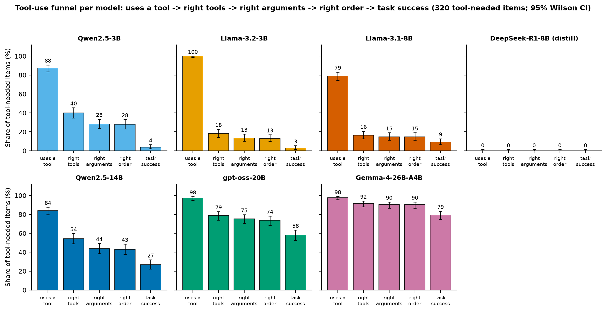

The largest average loss is at 'uses a tool -> right tools' (35.3 percentage points on average); the funnel shows where each model's tool use breaks: selecting, filling arguments, ordering or finishing. Models included (average over these 7): Qwen2.5-3B, Llama-3.2-3B, Llama-3.1-8B, DeepSeek-R1-8B (distill), Qwen2.5-14B, gpt-oss-20B, Gemma-4-26B-A4B; excluded: Mistral-Small-3.2-24B †: unreliable, 229/375 replies discarded by Ollama's parser (serving bug), excluded from ranking and size/family claims.

### Ranking on tool selection versus task success

| Model | Selection F1 [95% CI] | Rank (tool selection) | Task success % | Rank (task success) |
|---|---|---|---|---|
| Gemma-4-26B-A4B | 78.1 [75.4, 80.8] | 1 | 76.3 | 1 |
| gpt-oss-20B | 77.0 [73.9, 79.9] | 2 | 56.8 | 2 |
| Qwen2.5-14B | 55.5 [51.9, 59.0] | 3 | 26.9 | 3 |
| Llama-3.2-3B | 44.1 [40.7, 47.5] | 4 | 7.5 | 5 |
| Qwen2.5-3B | 40.4 [37.0, 43.8] | 5 | 3.5 | 7 |
| Llama-3.1-8B | 37.5 [33.7, 41.4] | 6 | 11.2 | 4 |
| DeepSeek-R1-8B (distill) | 0.0 [0.0, 0.0] | 7 | 6.4 | 6 |
Spearman rho between the two rankings: 0.82 (7 reliable models; indicative only). Mistral-Small-3.2-24B † is excluded from both rankings (selection F1 15.4 [11.7, 19.2], task success 5.1%).

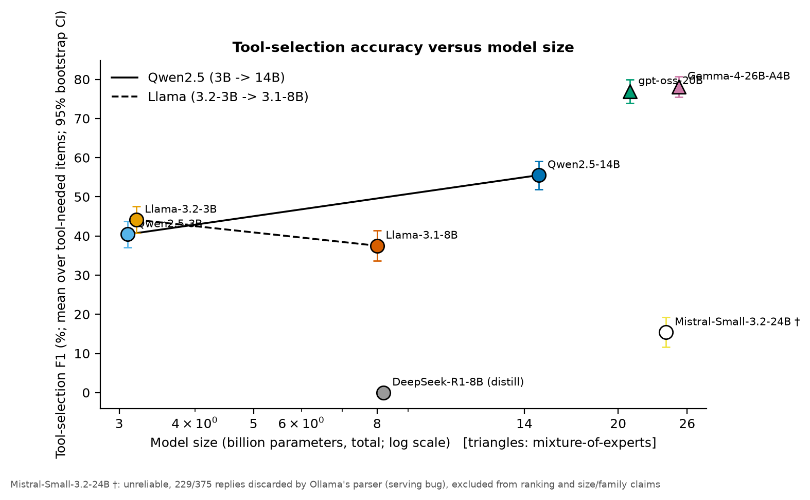

Tool-selection F1 within families: Qwen 40% -> 56% (higher with size); Llama 44% -> 38% (not higher with size). Across the 7 reliable models Spearman rho between size and selection F1 = 0.68 (p = 0.094).

### Per language and model x language

| Language | use | recall | precision | F1 | first call | arg. validity | arg. accuracy |
|---|---|---|---|---|---|---|---|
| English | 81.9 [78.1, 85.2] | 59.2 [55.2, 63.3] | 69.1 [65.5, 72.6] | 50.1 [46.7, 53.5] | 39.1 [34.7, 43.7] | 73.1 [66.3, 79.5] | 71.9 [67.4, 76.5] |
| Hinglish | 77.2 [73.1, 80.9] | 52.7 [48.5, 56.8] | 68.3 [64.5, 72.0] | 46.0 [42.6, 49.5] | 34.4 [30.1, 38.9] | 72.6 [64.3, 79.3] | 68.9 [64.0, 73.6] |
| Hindi | 77.5 [73.4, 81.1] | 56.8 [52.8, 60.8] | 70.5 [66.9, 73.8] | 49.2 [45.8, 52.7] | 36.6 [32.3, 41.2] | 72.6 [64.5, 79.8] | 70.1 [65.3, 74.8] |
| Marathi | 77.9 [73.8, 81.5] | 54.4 [50.3, 58.4] | 68.8 [65.2, 72.4] | 47.3 [43.9, 50.7] | 35.3 [31.0, 39.8] | 69.5 [60.7, 77.6] | 64.6 [59.6, 69.5] |
| Gujarati | 75.4 [71.3, 79.2] | 49.9 [45.8, 53.9] | 68.7 [64.9, 72.4] | 45.0 [41.4, 48.5] | 37.7 [33.4, 42.3] | 82.0 [77.6, 85.8] | 70.9 [66.0, 75.6] |

Pooled over the 7 reliable models (same set as figures 9 and 10; excluded: Mistral-Small-3.2-24B †: unreliable, 229/375 replies discarded by Ollama's parser (serving bug), excluded from ranking and size/family claims). Selection F1 per model and language (64 items per cell, `analysis/results_final/tool_metrics_by_model_language.csv` has every metric with intervals):

| Model | English | Hinglish | Hindi | Marathi | Gujarati |
|---|---|---|---|---|---|
| Qwen2.5-3B | 45 [38, 52] | 36 [28, 44] | 44 [37, 52] | 38 [31, 46] | 38 [31, 46] |
| Llama-3.2-3B | 49 [41, 57] | 42 [35, 49] | 48 [40, 55] | 45 [37, 52] | 37 [30, 45] |
| Llama-3.1-8B | 40 [32, 49] | 34 [25, 42] | 39 [30, 47] | 44 [36, 52] | 32 [23, 41] |
| DeepSeek-R1-8B (distill) | 0 [0, 0] | 0 [0, 0] | 0 [0, 0] | 0 [0, 0] | 0 [0, 0] |
| Qwen2.5-14B | 59 [51, 66] | 57 [50, 64] | 58 [50, 66] | 50 [42, 59] | 54 [45, 62] |
| gpt-oss-20B | 78 [71, 85] | 76 [68, 82] | 77 [69, 83] | 77 [71, 83] | 77 [70, 83] |
| Gemma-4-26B-A4B | 80 [74, 85] | 78 [71, 84] | 79 [73, 85] | 77 [70, 83] | 77 [71, 83] |

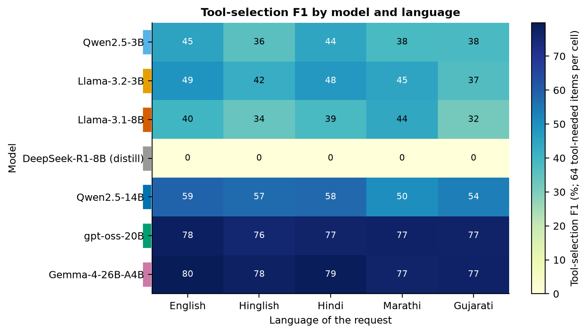

Tool-selection F1 by model and language (64 tool-needed items per cell); language means over the 7 included models: English 50, Hinglish 46, Hindi 49, Marathi 47, Gujarati 45. Models included: Qwen2.5-3B, Llama-3.2-3B, Llama-3.1-8B, DeepSeek-R1-8B (distill), Qwen2.5-14B, gpt-oss-20B, Gemma-4-26B-A4B; excluded: Mistral-Small-3.2-24B †: unreliable, 229/375 replies discarded by Ollama's parser (serving bug), excluded from ranking and size/family claims.

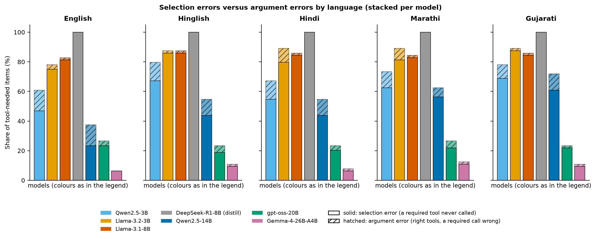

Share of tool-needed items lost at tool selection versus at arguments (mean over the 7 included models: Qwen2.5-3B, Llama-3.2-3B, Llama-3.1-8B, DeepSeek-R1-8B (distill), Qwen2.5-14B, gpt-oss-20B, Gemma-4-26B-A4B): English 51% vs 5%; Hinglish 59% vs 5%; Hindi 56% vs 6%; Marathi 59% vs 5%; Gujarati 62% vs 4%.

### Argument fields (accuracy of the literal gold arguments of the required calls)

| Model | class | date | passenger | station code | station name (resolve) | time window | train id |
|---|---|---|---|---|---|---|---|
| Qwen2.5-3B | 44 [40, 49] | 62 [56, 69] | 55 [47, 62] | 20 [17, 25] | 40 [35, 45] | 12 [4, 30] | 29 [25, 33] |
| Llama-3.2-3B | 40 [36, 45] | 74 [67, 79] | 47 [39, 54] | 15 [12, 19] | 3 [2, 6] | 36 [20, 55] | 21 [18, 25] |
| Llama-3.1-8B | 23 [19, 27] | 62 [55, 68] | 33 [27, 41] | 14 [11, 18] | 4 [2, 6] | 28 [14, 48] | 14 [11, 17] |
| DeepSeek-R1-8B (distill) | 0 [0, 1] | 0 [0, 2] | 0 [0, 2] | 0 [0, 1] | 0 [0, 1] | 0 [0, 13] | 0 [0, 1] |
| Qwen2.5-14B | 69 [64, 73] | 78 [72, 83] | 79 [72, 84] | 66 [61, 70] | 67 [62, 71] | 44 [27, 63] | 47 [43, 51] |
| gpt-oss-20B | 86 [82, 89] | 91 [86, 94] | 78 [71, 84] | 96 [94, 98] | 97 [94, 98] | 60 [41, 77] | 81 [77, 84] |
| Gemma-4-26B-A4B | 97 [95, 98] | 98 [94, 99] | 96 [92, 98] | 100 [99, 100] | 100 [99, 100] | 64 [45, 80] | 95 [93, 96] |
| Mistral-Small-3.2-24B † | 11 [8, 14] | 1 [0, 4] | 8 [5, 13] | 1 [0, 2] | 0 [0, 1] | 0 [0, 13] | 13 [10, 16] |

### Tool confusion (7 reliable models pooled; expected tool = row, called tool = column; `analysis/results_final/tool_confusion_<model>.csv` per model)

| expected \ called | resolve_station | search_trains | get_train_details | check_availability | get_fare | book_ticket | (not called) |
|---|---|---|---|---|---|---|---|
| resolve_station | 1239 | 36 | 38 | 16 | 4 | 20 | 1237 |
| search_trains | 2 | 937 | 0 | 0 | 1 | 3 | 457 |
| get_train_details | 44 | 32 | 199 | 8 | 2 | 13 | 157 |
| check_availability | 23 | 19 | 5 | 443 | 0 | 26 | 289 |
| get_fare | 35 | 26 | 24 | 16 | 493 | 14 | 547 |
| book_ticket | 40 | 15 | 1 | 10 | 1 | 663 | 425 |
| (not required) | 1350 | 536 | 582 | 654 | 438 | 663 | 0 |

## 5. Caveats

- DeepSeek-R1-0528-Qwen3-8B is a distill; with the shared settings `think:false` is not honoured (it still thinks) and it never made a native tool call (0 tool calls in the whole 375-item run, thinking text in every reply): it is a reported negative result, run with the same settings.
- Mistral-Small-3.2-24B † is **unreliable**: 229/375 replies were discarded by Ollama's tool-call parser (a serving bug, not a model decision); the discards are counted as failures (scoring unchanged), shown in the 'Server failures' column and the failure table (`malformed_model_output`), and the model is excluded from rankings and from size/family conclusions. Qwen2.5-3B also lost replies to the parser (valid calls with a nested `time_window`); see the by-language discard table.
- Floor effect: 5 of the 8 models score at or below the 12.0% null baseline, so language comparisons are only reported as interpretable for the 3 models well above it (Qwen2.5-14B, gpt-oss-20B, Gemma-4-26B-A4B).
- Missing final-block fields are not defaulted (no scoring change); the diagnostic table in section 3 counts the failures that have that cause only.
- `output_truncated`: replies that hit the 2048-token cap (concentrated in Gujarati); the text of rejected turns is not logged.
- The 3B baselines were re-run under the 2.1.0 settings; the old pilot results (Ollama 0.40.3, 8192/1024) are not comparable.
- Intervals on single model x language cells (75 items; 64 tool-needed) are wide; differences between neighbouring models are often not significant (see the McNemar table).
- Model sizes are the parameter counts Ollama reports (total parameters; the two mixture-of-experts models have about 4B active).

## 6. Was thinking really off? (recorded requests and responses)

From every recorded request (`think` value sent) and response (`thinking` field or `<think>` text) in the run files (`analysis/results_final/think_audit.csv`):

| Model | Capabilities | think config | think effective | Requests by `think` value | Responses | With a `thinking` field | With `<think>` in content | Thinking characters |
|---|---|---|---|---|---|---|---|---|
| Qwen2.5-3B | completion, tools | False | None | {"null": 976} | 976 | 0 | 0 | 0 |
| Llama-3.2-3B | completion, tools | False | None | {"null": 738} | 738 | 0 | 0 | 0 |
| Llama-3.1-8B | completion, tools | False | None | {"null": 637} | 637 | 0 | 0 | 0 |
| DeepSeek-R1-8B (distill) | tools, thinking, completion | False | False | {"false": 291} | 291 | 291 | 0 | 507626 |
| Qwen2.5-14B | completion, tools | False | None | {"null": 944} | 944 | 0 | 0 | 0 |
| gpt-oss-20B | completion, tools, thinking | False | low | {"\"low\"": 1902} | 1902 | 1532 | 0 | 102549 |
| Gemma-4-26B-A4B | completion, vision, tools, thinking | False | False | {"false": 1498} | 1498 | 0 | 0 | 0 |
| Mistral-Small-3.2-24B † | completion, vision, tools | False | None | {"null": 232} | 232 | 0 | 0 | 0 |

- **Gemma-4-26B**: `think: false` was sent in 1498 of 1498 requests and 0 of 1498 responses carry a thinking field (0 characters): thinking was really off.
- **gpt-oss-20B** cannot switch thinking off (the model always reasons); the adapter sent `think: "low"` (the lowest level) in 1902 of 1902 requests, recorded `think_effective = low`; 1532 of 1902 responses have a short thinking field (67 characters on average).
- **DeepSeek-R1-8B**: `think: false` was sent in 291 requests, yet 291 of 291 responses carry thinking text (the setting is not honoured).

## 7. Reproduce

```bash
PYTHONPATH=. ~/FreeModel/viz-venv/bin/python -m analysis.build_results --status runs/full_phase_20261124T105853Z.status.json
```

Outputs: `analysis/results_final/` (CSV/JSON tables and statistics), `analysis/figures_final/` (charts PNG 2x + PDF, `captions.md`, `pipeline.*`, the animated GIF, `examples.md`, LaTeX tables), this file.
